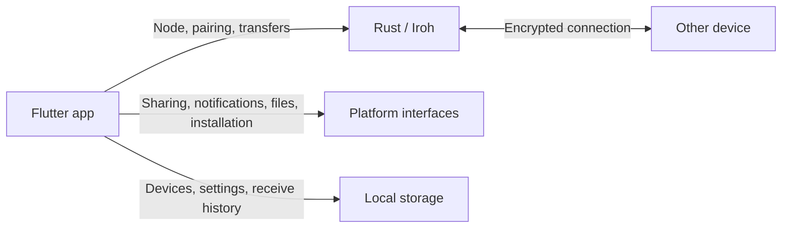

# Vela architecture

[简体中文](architecture.zh-CN.md)

Flutter manages UI choices, confirmations, and application state. Rust owns device trust, connections, and transfers. Native code integrates with system sharing, notifications, background execution, file access, and update installation.

Start with a two-node Rust test to see how a send completes, then follow Dart's `receiveAcceptedContent` to see how the receiver saves the content. [Two-node transfer tests](../rust/src/api/node_tests.rs) · [Receive flow](../lib/received_content.dart)

## Find the entry point for a change

| Change | Start here |
| --- | --- |
| Home screen, share actions, active task | [main.dart](../lib/main.dart), [home_toolbar.dart](../lib/home_toolbar.dart), [home_device_widgets.dart](../lib/home_device_widgets.dart) |
| Node startup and shutdown | [app_runtime.dart](../lib/app_runtime.dart), [Rust runtime](../rust/src/api/node/runtime.rs) |
| Pairing, device removal, trust sync | [pairing_session.dart](../lib/pairing_session.dart), [paired_devices.dart](../lib/paired_devices.dart), [Rust trust](../rust/src/trust.rs) |
| Reachability, network changes, wake | [presence_controller.dart](../lib/presence_controller.dart), [Rust presence](../rust/src/presence.rs), [proof_clock.rs](../rust/src/proof_clock.rs) |
| Sending, cancellation, retries | [pending_share.dart](../lib/pending_share.dart), [prepared_transfer.dart](../lib/prepared_transfer.dart), [send_session.dart](../lib/send_session.dart), [Rust transfer](../rust/src/api/node/transfer.rs) |
| Receive approval, files, clipboard | [incoming_offer_prompt.dart](../lib/incoming_offer_prompt.dart), [received_content.dart](../lib/received_content.dart), [received_storage.dart](../lib/received_storage.dart) |
| Background operation and system events | [background_settings.dart](../lib/background_settings.dart), [Android AppChannels](../android/app/src/main/kotlin/com/example/vela/AppChannels.kt), [macOS AppDelegate](../macos/Runner/AppDelegate.swift), [Windows integration](../windows/runner/desktop_integration.cpp), [Linux integration](../linux/runner/desktop_integration.cc) |
| Update checks, downloads, installation | [app_update.dart](../lib/app_update.dart), [app_update_tile.dart](../lib/app_update_tile.dart), [macOS update feed](../lib/mac_update_feed.dart), [release tools](../tool/release/) |

## Node and device relationships

`AppRuntime.start` reads the device identity and paired-device snapshot, starts the node, and synchronizes trust. After startup, the app owns the node, device store, and presence subscription. Shutdown invalidates results from outstanding tasks, waits for device transactions to finish, and closes the node. If startup is interrupted, the startup flow cleans up what it created.

Each side confirms and commits its local pairing. The initiator waits for the receiver to approve. The receiver saves its pairing after user approval and then replies. The session remains isolated until incoming and outgoing pairing attempts for that device have both finished.

A change to the device set first revokes trust where needed, then saves the device snapshot, and finally grants new trust. A failed write restores the previous trust state. Pairing, receiving, and asynchronous revocation check the current relationship through `pairingRevisionFor`. Rust uses its trust session to decide whether a connection is still authorized.

## Reachability and background operation

Rust updates reachability evidence and its expiry after verifying a response. Flutter's `readCurrentSnapshot` reads it, `_watchSnapshotUpdates` listens for changes, and `requestPeerProbes` requests a probe. Wake handling invalidates stale evidence before recovering the connection. Probe statistics support diagnostics.

Android's receiving service can start the shared FlutterEngine without an Activity. `AppChannels` dispatches system actions according to whether the app is in the foreground or background. macOS stays available in the menu bar. Windows and Linux use the tray for window visibility, notifications, and quitting. An open connection, valid reachability evidence, and peer authorization are independent states.

## Send and receive

`PreparedTransfer` holds the content and any temporary files owned by the app. A single-use Rust `TransferJob` performs each transfer. Each node runs one transfer at a time, and cancellation and progress belong to the job that created them.

A retry reuses the prepared content and checks the target's pairing revision again. Regular files use their original paths. The app manages temporary clipboard content, archives, share staging, and files materialized from URIs. On success or discard, `SendSession.release` releases platform access and app-owned temporary files.

The receiver rechecks the pairing revision after user approval and again after selecting the destination. Rust verifies the content, flushes the files, and replies to the sender. Android then saves the staged file to the chosen destination. The sender can see a successful transfer while that final local save is still in progress. A failed save keeps a private copy. Canceling the save removes the staged file.

A history record's `fileReference` can be a local path or an Android document URI. Open, export, and delete actions go through `ReceivedStorage`. The UI displays `displayPath`. Desktop file operations use `directoryPath`.

## App updates

`AppUpdateController` reads the signed update manifest and checks the target, download size, and SHA-256. Installing requires user confirmation and waits for transfers, folder operations, and pairing to finish. The app completes storage transactions before closing the node.

After confirmation, macOS passes the cached ZIP to Sparkle through a local appcast. Windows runs the verified installer, Linux uses a standalone helper to replace the AppImage, and Android hands off to the system installer. Publishing makes the version and its installers public before refreshing the rolling update feeds. [Release workflow](releasing.md)

## Data and interfaces

| Data or contract | Owner |
| --- | --- |
| Device identity keys and relay credentials | `AppRuntime` uses the system's secure storage |
| Paired devices, names, types, and local aliases | `PeerStore` saves per-profile snapshots in `peer_state_v2.sqlite3` |
| Settings and receive history | `SharedPreferences`, with receive history managed by `TransferHistoryStore` |
| Received files and share staging | Files are saved to the user's chosen location. The preparation and transfer flows clean temporary files according to ownership |
| Network and history types | `TransferKind` and `HistoryKind` are translated in `content_kind.dart`. Preserve existing protocol and storage strings |
| Stable error codes and presence messages | Rust's `failure_code.rs` defines error prefixes, and Dart's `transfer_failure.dart` parses them. `protocol.rs` encodes and decodes presence messages |

Platform code reports window visibility, wake, network, and quit events through `vela/background`. It installs updates through `vela/update`. Linux sends clipboard images through `vela/clipboard`. macOS updates node status, transfer status, and incoming notifications independently. Finishing a transfer preserves a node error.

Generate `lib/src/rust/`, `rust/src/frb_generated.rs`, and `lib/l10n/generated/` from the Rust API or localization resources. [Generation and local checks](../CONTRIBUTING.md#make-a-change)

## Find tests by feature

| Change | First tests to run |
| --- | --- |
| Pairing and device writes | [paired_devices_test.dart](../test/paired_devices_test.dart), [pairing_session_test.dart](../test/pairing_session_test.dart) |
| Node lifecycle and reachability | [app_runtime_test.dart](../test/app_runtime_test.dart), [presence_controller_test.dart](../test/presence_controller_test.dart) |
| Content preparation, receiving, and saving | [prepared_transfer_test.dart](../test/prepared_transfer_test.dart), [received_content_test.dart](../test/received_content_test.dart), [received_storage_test.dart](../test/received_storage_test.dart) |
| Protocol, transfers, and cancellation | [node_tests.rs](../rust/src/api/node_tests.rs), [proof_clock_tests.rs](../rust/src/proof_clock_tests.rs) |
| Background behavior, desktop storage, and updates | [background_settings_test.dart](../test/background_settings_test.dart), [received_storage_desktop_test.dart](../test/received_storage_desktop_test.dart), [app_update_test.dart](../test/app_update_test.dart) |
| Platform integration and real devices | [Debug drivers](../test_driver/), [Release acceptance checklist](launch-checklist.md) |

Dart tests share [fakes.dart](../test/support/fakes.dart). Run the tests relevant to the change first. The contributing guide explains when to use CI, installers, or device testing. [Verification commands](../CONTRIBUTING.md#verify)
