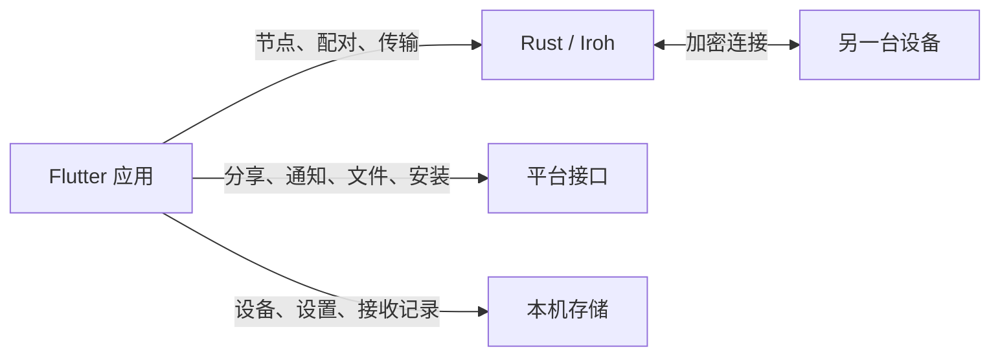

# Vela 代码地图

[English](architecture.md)

Flutter 管理界面里的选择、确认和应用状态。Rust 管理设备信任、连接和传输。原生层负责系统分享、通知、后台运行、文件访问和更新安装。

第一次读代码，可以从 Rust 的双节点测试看一次发送怎样完成，再从 Dart 的 `receiveAcceptedContent` 看内容怎样保存。 [双节点收发测试](../rust/src/api/node_tests.rs) · [接收编排](../lib/received_content.dart)

## 从改动找入口

| 要改什么 | 先看这里 |
| --- | --- |
| 首页、分享入口、当前任务 | [main.dart](../lib/main.dart)、[home_toolbar.dart](../lib/home_toolbar.dart)、[home_device_widgets.dart](../lib/home_device_widgets.dart) |
| 节点启动与关闭 | [app_runtime.dart](../lib/app_runtime.dart)、[Rust runtime](../rust/src/api/node/runtime.rs) |
| 配对、移除设备、信任同步 | [pairing_session.dart](../lib/pairing_session.dart)、[paired_devices.dart](../lib/paired_devices.dart)、[Rust trust](../rust/src/trust.rs) |
| 设备可达性、网络切换、唤醒 | [presence_controller.dart](../lib/presence_controller.dart)、[Rust presence](../rust/src/presence.rs)、[proof_clock.rs](../rust/src/proof_clock.rs) |
| 发送、取消、失败重试 | [pending_share.dart](../lib/pending_share.dart)、[prepared_transfer.dart](../lib/prepared_transfer.dart)、[send_session.dart](../lib/send_session.dart)、[Rust transfer](../rust/src/api/node/transfer.rs) |
| 接收确认、文件、剪贴板 | [incoming_offer_prompt.dart](../lib/incoming_offer_prompt.dart)、[received_content.dart](../lib/received_content.dart)、[received_storage.dart](../lib/received_storage.dart) |
| 后台运行和系统事件 | [background_settings.dart](../lib/background_settings.dart)、[Android AppChannels](../android/app/src/main/kotlin/com/example/vela/AppChannels.kt)、[macOS AppDelegate](../macos/Runner/AppDelegate.swift)、[Windows 集成](../windows/runner/desktop_integration.cpp)、[Linux 集成](../linux/runner/desktop_integration.cc) |
| 检查、下载和安装更新 | [app_update.dart](../lib/app_update.dart)、[app_update_tile.dart](../lib/app_update_tile.dart)、[macOS 更新源](../lib/mac_update_feed.dart)、[发布工具](../tool/release/) |

## 节点与设备关系

`AppRuntime.start` 读取设备身份和已配对设备的快照，启动节点并同步信任。启动成功后，应用接管节点、设备存储和在线状态订阅。关闭时先让旧任务的结果失效，等待设备事务收尾，再关闭节点。启动被中途取消时，由原启动流程清理它创建的资源。

配对两端分别确认和提交本机设备关系。发起端等接收端同意，接收端先经用户同意并持久化本机配对关系，再回复发起端。对同一设备的入站和出站配对都结束后才能解除会话隔离。

写入设备集合时，先收缩信任，再保存设备快照，最后授予新增信任。写入失败时恢复旧信任。配对、接收和异步撤销都用 `pairingRevisionFor` 复核当前设备关系。Rust 再用信任会话决定连接是否仍获授权。

## 可达性与后台运行

Rust 在收到已验证的响应后更新在线证据及有效期。Flutter 的 `readCurrentSnapshot` 读取证据，`_watchSnapshotUpdates` 监听变化，`requestPeerProbes` 发起探测。系统唤醒后先让旧证据失效，再恢复连接。探测统计用于诊断。

Android 的接收服务可以在没有 Activity 时启动共享 FlutterEngine。`AppChannels` 负责区分应用在前台和后台时可用的系统操作。macOS 通过菜单栏继续运行，Windows 和 Linux 通过托盘处理窗口可见性、通知和退出。设备当前有没有连接、在线证据是否有效、对方是否仍授权，各有独立状态。

## 发送与接收

`PreparedTransfer` 持有要发的内容以及应用拥有的临时文件。一次传输由一个单次使用的 Rust `TransferJob` 执行，一个节点同时只运行一个传输。取消和进度都归属于创建它们的任务。

失败重试复用已准备的内容，并再次检查目标设备的配对版本。普通文件沿用用户原路径。剪贴板、归档、分享暂存和从 URI 物化的文件由应用管理。成功或放弃后，`SendSession.release` 释放平台凭据和应用临时文件。

接收端在用户确认后和选好保存位置后分别复核配对版本。Rust 验证内容、刷新文件并回复发送方。Android 后续还要把暂存文件保存到所选位置。因此发送方看到传输成功时，接收端可能还在完成本地保存。保存失败会保留应用私有副本，取消保存则清理暂存。

历史里的 `fileReference` 可以是本地路径或 Android 文档 URI。打开、导出和删除都通过 `ReceivedStorage`。界面用 `displayPath` 展示位置，桌面文件操作使用 `directoryPath`。

## 应用更新

`AppUpdateController` 读取已签名的更新清单，核对目标、下载大小和 SHA-256。安装前需要用户确认，并等待传输、文件夹处理和配对结束。关闭节点前会先收尾持久化事务。

macOS 在确认后把缓存的 ZIP 通过本机 appcast 交给 Sparkle。Windows 运行已验证的安装器，Linux 通过独立 helper 替换 AppImage，Android 交给系统安装器。发布时先公开版本和安装包，再刷新滚动更新源。 [发布流程](releasing.zh-CN.md)

## 数据与接口

| 数据或约定 | 所有者 |
| --- | --- |
| 设备身份密钥和中继凭据 | `AppRuntime` 使用系统安全存储 |
| 已配对设备、名称、类型和本机别名 | `PeerStore` 在 `peer_state_v2.sqlite3` 内按 profile 保存快照 |
| 普通设置与接收记录 | `SharedPreferences`，接收记录由 `TransferHistoryStore` 管理 |
| 接收文件与分享暂存 | 接收文件位于用户选择的位置。临时分享文件由准备和传输流程按所有权清理 |
| 网络类型与历史类型 | `TransferKind` 和 `HistoryKind` 在 `content_kind.dart` 转换。保留已有协议和存储字符串 |
| 稳定错误码与在线报文 | Rust 的 `failure_code.rs` 定义错误前缀，Dart 的 `transfer_failure.dart` 解析。在线报文由 `protocol.rs` 编解码 |

平台通过 `vela/background` 通知窗口可见性、唤醒、网络和退出，通过 `vela/update` 安装更新。Linux 图片剪贴板使用 `vela/clipboard`。macOS 的节点状态、传输状态和入站通知分别更新，传输结束时保留节点错误。

`lib/src/rust/`、`rust/src/frb_generated.rs` 和 `lib/l10n/generated/` 从 Rust API 或语言资源生成。 [生成命令与本地检查](../CONTRIBUTING.zh-CN.md#修改代码)

## 按功能找测试

| 改动 | 首选测试 |
| --- | --- |
| 配对与设备写入 | [paired_devices_test.dart](../test/paired_devices_test.dart)、[pairing_session_test.dart](../test/pairing_session_test.dart) |
| 节点生命周期与在线状态 | [app_runtime_test.dart](../test/app_runtime_test.dart)、[presence_controller_test.dart](../test/presence_controller_test.dart) |
| 内容准备、接收与保存 | [prepared_transfer_test.dart](../test/prepared_transfer_test.dart)、[received_content_test.dart](../test/received_content_test.dart)、[received_storage_test.dart](../test/received_storage_test.dart) |
| 协议、收发与取消 | [node_tests.rs](../rust/src/api/node_tests.rs)、[proof_clock_tests.rs](../rust/src/proof_clock_tests.rs) |
| 后台、桌面存储、更新 | [background_settings_test.dart](../test/background_settings_test.dart)、[received_storage_desktop_test.dart](../test/received_storage_desktop_test.dart)、[app_update_test.dart](../test/app_update_test.dart) |
| 平台集成与真实设备 | [调试驱动](../test_driver/)、[发布验收清单](launch-checklist.zh-CN.md) |

Dart 测试共用 [fakes.dart](../test/support/fakes.dart)。先运行与改动直接相关的测试，再按贡献指南选择 CI、安装包或实机验证。 [验证命令](../CONTRIBUTING.zh-CN.md#验证)
